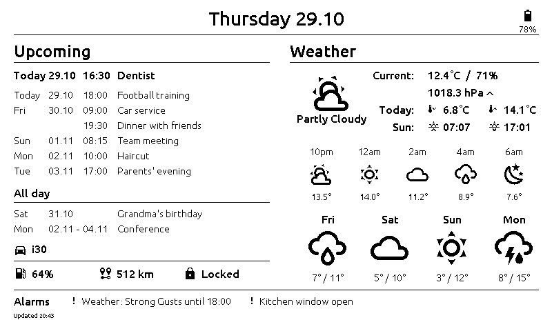
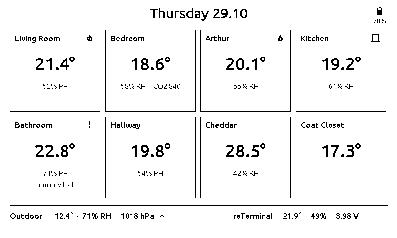
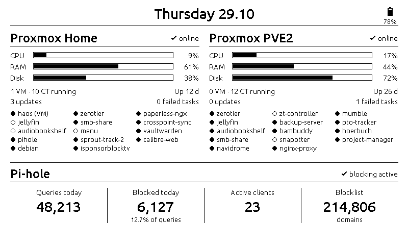

# reTerminal HA Dashboard

[](https://github.com/Boisti13/reterminal-ha-dashboard/releases)
[](LICENSE)
[](https://esphome.io/)
[](packages/)


An e-paper wall dashboard for the **Seeed reTerminal E-series** (ESP32-S3,
7.5" 800×480 black-and-white e-paper), fed by
[Home Assistant](https://www.home-assistant.io/). It runs
[ESPHome](https://esphome.io/): it wakes every two hours, pulls its data
from Home Assistant, draws one page and goes back into deep sleep. The
picture stays on the e-paper while it sleeps. Three buttons wake it for the
other two pages.



## Highlights

- **Overview at a glance**: the next appointment and the next 7 days
  (timed and all-day events), current weather with sunrise and sunset, a
  +2 h to +10 h forecast, 4 days ahead, the car's fuel, range and lock
  state, and an **alarm bar** with everything that needs attention
- **One alarm list** built in Home Assistant (`sensor.reterminal_alarms`):
  water leaks, weather warnings, internet down, servers offline, CO₂ too
  high, windows or car left open, low batteries — sorted by priority, up
  to two lines, then "+N more"; "All clear" when nothing is wrong
- **Climate page**: eight rooms with temperature, humidity and CO₂, a flame
  while the radiator heats, a window icon when it's open, and a "!" with
  the reason when a room is too cold, too warm, too humid or too dry
- **Homelab page**: two Proxmox hosts (online, CPU, RAM, disk, running
  guests, updates, failed tasks, uptime, one dot per guest) and Pi-hole
- **Battery-friendly**: one refresh per wake, deep sleep in between; no
  wakes between midnight and 06:00; every 6 h instead of 2 h below 15 %
  battery, with "Charge battery" in the header
- **Fast wakes**: fixed IP, no Wi-Fi scan, no firmware check after deep
  sleep; it draws as soon as Home Assistant has sent its values (usually
  well under a second after connecting)
- **Battery percentage from a LiPo discharge curve**, not a straight line
  between two voltages
- **All the data shaping happens in Home Assistant** (`packages/`): the
  device only reads ready-made sensors, so most changes need no flash

| Overview | Climate | Homelab |
|---|---|---|
|  |  |  |

The screenshots are rendered on a PC from the same drawing code, with
made-up values (see [Development](#development)).

## Pages and buttons

| Page | Wake with | Shows |
|---|---|---|
| **Overview** | timer, or the right key (KEY2) | Calendar, weather, hourly and daily forecast, car, alarm bar, "Updated HH:MM" |
| **Climate** | left key (KEY0) | 8 room tiles, outdoor temperature, humidity and pressure trend, the reTerminal's own sensor and battery voltage |
| **Homelab** | middle key (KEY1) | Two Proxmox hosts side by side (title of the second one: `homelab_host2_title` in `reterminal.yaml`), Pi-hole statistics |

A short press is enough, also from deep sleep. Climate and Homelab stay up
for 30 s (each key press restarts that), then the Overview is drawn again so
that's what stays on the screen while it sleeps.

### What a wake looks like

1. The timer or a key wakes the ESP32-S3; it turns on the battery
   measurement and picks the page from the key that woke it
   (`page_wake.h`).
2. Wi-Fi connects with a fixed IP, the Home Assistant API connects, and the
   device waits until the weather, the calendar and the first room have
   arrived (at most 30 s), then up to 1.5 s more for the rest. Missing
   entities are logged, not waited for.
3. It draws the page. Climate or Homelab: 30 s, then the Overview.
4. Deep sleep for 2 h (6 h below 15 % battery). A wake that would fall
   between 00:00 and 06:00 is moved to 06:00. The keys work at any time.

## Hardware

| Part | Pins / notes |
|---|---|
| Board | Seeed reTerminal E1001 (E-series, ESP32-S3, black-and-white panel) |
| E-paper 7.5" 800×480 | `waveshare_epaper` model `7.50inv2`; SPI CLK GPIO7, MOSI GPIO9; CS 10, DC 11, RST 12, BUSY 13 (inverted) |
| Keys KEY0 / KEY1 / KEY2 | GPIO5 / GPIO4 / GPIO3, active low; ext1 wake source |
| SHT4x temperature/humidity | I²C SDA GPIO19, SCL GPIO20, address 0x44 |
| Battery | GPIO21 switches the divider on, ADC on GPIO1 (×2); 4.20 V = 100 %, 3.30 V = 0 % |

## Install

| Step | What to do |
|---|---|
| 1. Packages | Turn on packages in Home Assistant (`homeassistant: packages: !include_dir_named packages`) and copy `packages/*.yaml` into your `packages/` folder. |
| 2. Your entities | Change the entity IDs to yours — see [Entities](#entities). Check with *Developer tools → YAML → Check configuration*, then restart or reload. |
| 3. ESPHome files | Copy `esphome/reterminal.yaml`, `esphome/reterminal_modules/` and `esphome/fonts/` into your ESPHome config folder (in Home Assistant: `/homeassistant/esphome/`). |
| 4. Secrets | Add the keys from `esphome/secrets.example.yaml` to your ESPHome `secrets.yaml` (`openssl rand -base64 32` makes an API key). |
| 5. Network | Set `wifi: manual_ip:` in `reterminal.yaml` to a free address in your network (or remove the block for DHCP — wakes get a little slower). |
| 6. Flash | The first time over USB; afterwards OTA, but only while the device is awake — press a key first. |
| 7. Home Assistant | Add the device (it's discovered) and turn on **Allow the device to perform Home Assistant actions** in its ESPHome options, so it can read your entities. |

## Entities

The device reads Home Assistant entities by ID. Some come from the packages
in this repository; the rest are your own and need to be changed to yours.

| File | Reads | Change |
|---|---|---|
| `packages/3day_weather.yaml`, `hourly_forecast.yaml` | `weather.forecast_home` | your weather entity |
| `packages/calendar_reterminal.yaml` | a calendar entity | your calendar |
| `packages/reterminal_alarms.yaml` | leak sensors, DWD warnings, Proxmox, Pi-hole, CO₂, windows, car, batteries | the list you want; thresholds are `input_number`s |
| `packages/water_leak.yaml` | leak sensors, notify services | your sensors and notify targets |
| `esphome/reterminal_modules/sensors.yaml` | rooms, outdoor, pressure, car | your sensors |
| `esphome/reterminal_modules/climate_entities.yaml` | radiators (`hvac_action`), window contacts | your climate and contact entities |
| `esphome/reterminal_modules/homelab_entities.yaml` | Proxmox VE and Pi-hole integrations | your nodes and guests |
| `esphome/reterminal_modules/page_climate.yaml` | room names and limits (`rooms[]`) | your rooms |
| `esphome/reterminal_modules/page_homelab.yaml` | guest names (`home_guests[]`, `rptu_guests[]`) | your guests |

Sensors made by the packages, all read by the device:

| Entity | Content |
|---|---|
| `sensor.reterminal_next_appointment` | `Thu 30.10 16:30  Dentist` (fixed positions) |
| `sensor.reterminal_next_7d_calendar` | one line per event: day label (14 chars), time, title |
| `sensor.reterminal_all_day_calendar` | `Sat|01.11||Title`, one per line (`none` if empty) |
| `sensor.reterminal_hourly_forecast_line_{2,4,6,8,10}` | `15h  13.5°C  partlycloudy` |
| `sensor.reterminal_forecast_day_{2..5}_{label,condition,temps}` | `Fri`, `rainy`, `7° / 11°` |
| `sensor.reterminal_today_temp_{min,max}` | today's forecast range |
| `sensor.reterminal_alarms` | active alarms joined with `|`, or `OK` |

## Example: adding a room

Say you want a *Study* tile instead of *Coat Closet* on the Climate page.

1. In `sensors.yaml`, point `temp_coat_closet` at `sensor.study_temperature`
   (or add a new `temp_study` / `hum_study` pair).
2. For a radiator and a window icon, add a `heat_study` text sensor
   (attribute `hvac_action`) and a `win_study` binary sensor to
   `climate_entities.yaml`.
3. In `page_climate.yaml`, change the last line of `rooms[]`:
   `{"Study", id(temp_study).state, id(hum_study).state, NAN, id(heat_study), id(win_study), 18, 26, true}`
   — the two numbers are the "too cold" / "too warm" limits, `true` also
   checks humidity (35–65 %).
4. Flash. The tile shows the flame while the radiator heats and
   "Too cold" with a "!" below 18 °C.

## Layout

```
esphome/
  reterminal.yaml            # device config: wake cycle, sleep, Wi-Fi, includes
  screenshot-demo.yaml       # the pages on a PC (SDL) with made-up values
  secrets.example.yaml       # keys to add to your secrets.yaml
  fonts/                     # Ubuntu Medium, Material Design Icons, licence
  reterminal_modules/
    hardware_spi.yaml / hardware_i2c.yaml / outputs.yaml
    display.yaml             # waveshare_epaper 7.50inv2 + page list
    page_overview.yaml       # calendar, weather, car, alarms
    page_climate.yaml        # room tiles
    page_homelab.yaml        # Proxmox hosts + Pi-hole
    homelab_entities.yaml    # Home Assistant entities for the Homelab page
    climate_entities.yaml    # radiator state + window contacts per room
    fonts.yaml
    sensors.yaml             # SHT4x, battery, numeric Home Assistant sensors
    text_sensors.yaml        # weather, calendar, forecast, alarm text sensors
    binary_sensors.yaml      # KEY0–2
    page_wake.h              # key → page at boot
    ui_header.h              # page header: date, battery icon and percent
    ui_weather.h             # condition → display text
packages/                    # Home Assistant packages that make sensor.reterminal_*
  3day_weather.yaml          # daily forecast labels, conditions, temperatures
  hourly_forecast.yaml       # hourly forecast lines
  calendar_reterminal.yaml   # next appointment, 7-day list, all-day events
  reterminal_alarms.yaml     # combined alarm list (CO₂ and battery thresholds as input_numbers)
  water_leak.yaml            # leak sensors → alert text and notifications
scripts/
  screenshots.sh             # renders docs/images/*.png
docs/images/                 # README screenshots
```

## Development

- **Check a change** with `esphome config esphome/reterminal.yaml` (or
  `compile`), using `secrets.example.yaml` as `secrets.yaml`; its dummy API
  key is valid base64, so the check passes.
- **Screenshots without the device** (Linux): `bash scripts/screenshots.sh`
  builds `esphome/screenshot-demo.yaml` for the PC with ESPHome's `host`
  platform and an SDL display, runs it in a virtual X display (Xvfb) and
  saves the three pages to `docs/images/`. Needs ESPHome, `libsdl2-dev`,
  `xvfb` and ImageMagick. `esphome run esphome/screenshot-demo.yaml` opens
  it in a window instead (white on black — the script inverts the images).
  The demo uses the same page files as the device, so look at the PNGs
  after every visible change.
- Work happens on `dev`; `main` only gets releases (tagged `vX.Y.Z`, with
  the CHANGELOG section as release notes). Changes go into
  [CHANGELOG.md](CHANGELOG.md).

## License

[MIT](LICENSE) for this project's files. The fonts in `esphome/fonts/` keep
their own licences (Ubuntu Font Licence 1.0, Apache 2.0) — see
[THIRD_PARTY_NOTICES.md](THIRD_PARTY_NOTICES.md).
